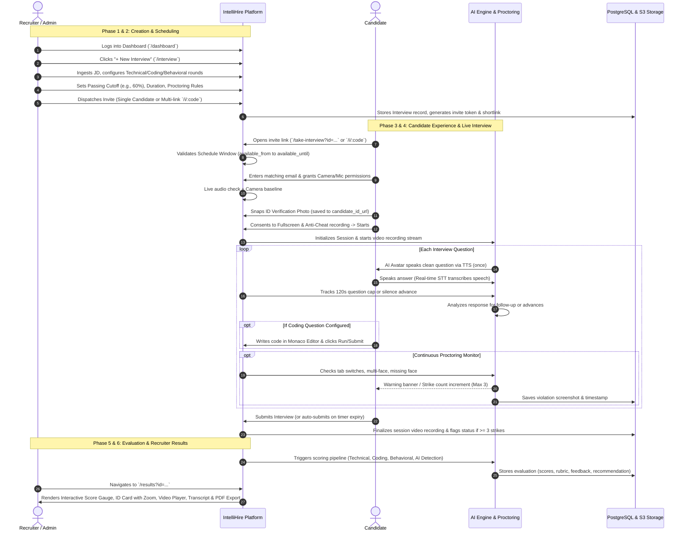

# Scaloz IntelliHire — Complete End-to-End System QA & Testing Master Guide

> **Document Version:** 3.0  
> **Classification:** QA Master Test Specification & Product Functional Reference  
> **Target Audience:** QA Engineers, Automation Engineers, Product Managers, Frontend/Backend Developers  
> **Last Updated:** September 2026  
> **Status:** Approved for End-to-End QA Test Execution & Traceability Matrix

---

## Table of Contents
1. [System Architecture & User Roles](#1-system-architecture--user-roles)
2. [End-to-End Workflow Diagram](#2-end-to-end-workflow-diagram)
3. [Phase 1: Recruiter & Admin Dashboard](#3-phase-1-recruiter--admin-dashboard)
4. [Phase 2: Interview Creation & Customization](#4-phase-2-interview-creation--customization)
5. [Phase 3: Candidate Access, Hardware Check & ID Verification](#5-phase-3-candidate-access-hardware-check--id-verification)
6. [Phase 4: Live AI Interview & Real-Time Proctoring](#6-phase-4-live-ai-interview--real-time-proctoring)
7. [Phase 5: Completion & Automated AI Evaluation Pipeline](#7-phase-5-completion--automated-ai-evaluation-pipeline)
8. [Phase 6: Recruiter Results, Interactive Scoring & Audit](#8-phase-6-recruiter-results-interactive-scoring--audit)
9. [Comprehensive QA Test Case Matrix (75+ Test Cases)](#9-comprehensive-qa-test-case-matrix)
   - [Suite 1: Auth, RBAC & Dashboard Operations](#suite-1-auth-rbac--dashboard-operations)
   - [Suite 2: Interview Configuration & Custom Questions](#suite-2-interview-configuration--custom-questions)
   - [Suite 3: Candidate Verification, Pre-Checks & ID Capture](#suite-3-candidate-verification-pre-checks--id-capture)
   - [Suite 4: Live AI Voice Agent, STT/TTS & Coding Flow](#suite-4-live-ai-voice-agent-stttts--coding-flow)
   - [Suite 5: Real-Time Proctoring, Tab-Switch & Strike System](#suite-5-real-time-proctoring-tab-switch--strike-system)
   - [Suite 6: Evaluation Engine, Scoring & AI Detection](#suite-6-evaluation-engine-scoring--ai-detection)
   - [Suite 7: Results Dashboard, Interactive Score Chart & ID Verification](#suite-7-results-dashboard-interactive-score-chart--id-verification)
   - [Suite 8: Video Player, Audit Evidence & PDF Export](#suite-8-video-player-audit-evidence--pdf-export)
   - [Suite 9: Negative Testing, Edge Cases & Security](#suite-9-negative-testing-edge-cases--security)
10. [QA Defect Severity Classification](#10-qa-defect-severity-classification)
11. [QA Release Sign-Off Checklist](#11-qa-release-sign-off-checklist)

---

## 1. System Architecture & User Roles

IntelliHire is an enterprise AI-driven interview orchestration and proctoring platform. It isolates data by organization/tenant and enforces strict Role-Based Access Control (RBAC).

```
                      ┌─────────────────────────────────────────┐
                      │        Scaloz Super Admin / SSO         │
                      └────────────────────┬────────────────────┘
                                           │
                      ┌────────────────────▼────────────────────┐
                      │              Tenant Admin               │
                      └────────────────────┬────────────────────┘
                                           │
                      ┌────────────────────▼────────────────────┐
                      │             Team Manager                │
                      └────────────────────┬────────────────────┘
                                           │
                      ┌────────────────────▼────────────────────┐
                      │              Recruiter                  │
                      └────────────────────┬────────────────────┘
                                           │
                      ┌────────────────────▼────────────────────┐
                      │              Candidate                  │ (Token / Shortlink Access)
                      └─────────────────────────────────────────┘
```

### User Roles & Permissions Matrix
| Role | Route Access | Dashboard Scope | Can Create Interview? | Can View Video & Scores? | Can Export PDF? |
| :--- | :--- | :--- | :--- | :--- | :--- |
| **Super Admin** | Platform-wide (`/super-admin`, `/admin`, `/dashboard`) | All tenants & global telemetry | Yes | Yes | Yes |
| **Admin** | Tenant-wide (`/admin`, `/admin/dashboard`, `/dashboard`) | Entire tenant roster, recruiters, stats | Yes | Yes | Yes |
| **Manager** | `/dashboard`, `/admin/dashboard`, `/results` | Assigned team recruiters & their candidates | Yes | Yes | Yes |
| **Recruiter** | `/dashboard`, `/interview`, `/results`, `/history` | Own interviews & invited candidates | Yes | Yes | Yes |
| **Candidate** | `/take-interview`, `/i/:shortCode` | Only assigned assessment session | No | No (Sees thank-you) | No |

---

## 2. End-to-End Workflow Diagram



---

## 3. Phase 1: Recruiter & Admin Dashboard

**Primary URL:** `/dashboard` or `/admin/dashboard`

### 1.1 Overview & Metrics
* **Hero Counters:**
  * **Total Interviews:** Count of all configured campaigns.
  * **Active Sessions:** Candidates currently taking an assessment.
  * **Completed:** Assessments finished and ready for review.
  * **Flagged Assessments:** Sessions where candidate exceeded proctoring strikes or had policy violations.
* **Top Navigation:**
  * Tenant/Organization branding badge.
  * User profile button with role pill (`ADMIN`, `RECRUITER`, `MANAGER`).
  * Action Buttons: `+ New Interview` primary CTA, `Reports / History`, `Logout`.

### 1.2 Recent Campaigns & Candidates Table
* Displays candidate name, email, job role, mode (Q&A, Coding, Combined), created date, and status pill:
  * `Pending`: Invite sent, candidate has not started.
  * `In Progress`: Candidate is currently inside the test room.
  * `Completed`: Candidate finished test, evaluation processed.
  * `Flagged`: Proctoring violations or policy termination triggered.
* **Actions per row:**
  * `View Results`: Direct link to `/results?id=<interviewId>`.
  * `Copy Link`: Copies the candidate's direct link to clipboard.
  * `Resend Invite`: Re-dispatches invitation email.

---

## 4. Phase 2: Interview Creation & Customization

**Primary URL:** `/interview`

### 2.1 Job Description (JD) Ingestion
* **Job Title & Role:** Free text (e.g., *"Senior Fullstack Developer"*).
* **Experience Level:** Junior (0–2 yrs), Mid-level (3–5 yrs), Senior (5+ yrs), Lead/Principal (8+ yrs).
* **JD Source:**
  * Option A: Paste Job Description text.
  * Option B: Upload JD file (`.pdf`, `.docx`, `.txt`).
* **AI Extraction:** System automatically parses skills, framework requirements, and core competencies.

### 2.2 Round Distribution & Weightage
Recruiters configure the exact composition of the interview:
* **Technical Round:** Number of questions (default: 4–6), difficulty slider.
* **Behavioral / Soft Skills Round:** Situational and STAR-method questions (default: 2–3).
* **Coding Assessment (Optional):** Algorithmic and live coding problems (0–3 challenges).
* **Question Customization:**
  * Recruiter can review generated questions.
  * Add custom fixed questions that the AI *must* ask.
  * Delete or re-order questions.
  * Set custom prompt instructions (e.g., *"Focus heavily on PostgreSQL indexing and concurrency"*).

### 2.3 Assessment & Proctoring Configuration
* **Session Duration:** Hard timer (e.g., 30, 45, 60 minutes).
* **Passing Benchmark Cutoff:** Configurable percentage threshold (default: `60%`, range: `40%–90%`). Determines candidate `Recommended` vs `Not Recommended` badge on results page.
* **Schedule Window:**
  * `available_from`: Earliest allowed candidate access timestamp.
  * `available_until`: Absolute expiration date/time.
* **Proctoring Rules:**
  * Video recording toggle (enabled by default).
  * Tab-switch penalty limit (default: 3 strikes).
  * Face liveness & multi-person detection toggle.

### 2.4 Candidate Scheduling Modes
* **Single Candidate:** Enters Candidate Name, Email, Phone.
* **Multi-Candidate Campaign:** Generates a short reusable URL (`/i/:shortCode`) for mass distribution or job boards.

---

## 5. Phase 3: Candidate Access, Hardware Check & ID Verification

**Primary URLs:** `/take-interview?id=<UUID>` or `/i/:shortCode`

### 5.1 Schedule Window Gatekeeper
The system verifies eligibility before granting access:
* **Early Attempt:** If `currentTime < available_from` $\rightarrow$ Displays: *"This interview has not started yet. Opens on [DateTime]"*.
* **Expired Attempt:** If `currentTime > available_until` $\rightarrow$ Displays: *"This interview invitation has expired"*.
* **Already Completed:** If session status is `completed` $\rightarrow$ Displays: *"You have already completed this assessment"*.

### 5.2 Email Authentication Gate
* If accessing via public multi-candidate link, candidate inputs their email.
* If accessing via dedicated single link, candidate confirms email. Verification prevents link tampering.

### 5.3 Hardware Pre-Flight Checks
Candidate must pass hardware validation checklist:
1. **Camera Permission & Stream:** WebRTC camera stream is acquired. Video preview is displayed.
2. **Microphone Level Meter:** Reactive audio bar pulses when candidate speaks.
3. **Speaker Test:** Audible test chime button ensures candidate can hear the AI interviewer.
4. **Network Latency Check:** Ping test confirms stable connection ($< 250\text{ms}$).

### 5.4 Candidate ID Photo Verification Snapshot
* System prompts: *"Position your face clearly within the frame for your check-in ID photo"*.
* Candidate clicks **"Capture Photo"** (or auto-snaps after countdown).
* The image is captured from the live video stream, uploaded to the server, and saved to `interview.candidate_id_url`.
* **Integrity Guarantee:** This photo is permanently stored and displayed in the Recruiter Results Dashboard for recruiter audit.

### 5.5 Fullscreen & Proctoring Consent
* Candidate checks agreement boxes:
  * Consent to audio/video recording.
  * Consent to automated proctoring (tab-switch and multi-face monitoring).
* Candidate clicks **"Enter Assessment Room"** $\rightarrow$ Activates browser fullscreen mode.

---

## 6. Phase 4: Live AI Interview & Real-Time Proctoring

**Primary URL:** `/take-interview` (Live Session)

### 6.1 Conversational AI Voice Agent
* **TTS (Text-to-Speech):**
  * Reads each interview question aloud upon transition.
  * **Single-Reading Rule:** The AI reads each question once. Redundant loops upon silence or skip are strictly blocked.
  * **Clean Lead-In Rule:** Conversational prefixes (e.g., *"Alright, moving on to the next question."*) are spoken but stripped from the on-screen question card to maintain a distraction-free card.
* **STT (Speech-to-Text):**
  * Real-time transcription captures candidate answers and displays live subtitle text.
* **Adaptive Follow-Up Questions:**
  * If candidate provides a brief or vague answer, the AI agent asks a clarifying follow-up (up to configured max per question).

### 6.2 Per-Question Timing & Advance Rules
* **120-Second Hard Cap:** Each question has a 120-second timer. If time expires, the answer is auto-committed and the session automatically advances.
* **Silence Auto-Advance:** If candidate remains silent for 5–7 seconds after speaking, the system prompts them or advances.
* **Manual Next / Skip:** Candidate can click *"Next Question"* when finished.

### 6.3 Live Coding Environment (When Enabled)
* **Monaco Code Editor:** Embedded syntax-highlighted IDE supporting Python, JavaScript, TypeScript, Java, C++, Go, and SQL.
* **Custom Inputs & Test Runner:** Candidate can click *"Run Code"* to test execution against sample inputs.
* **Code Submission:** Freezes solution, sends code to backend for automated unit test evaluation.

### 6.4 Real-Time Proctoring & Strike System
1. **Tab Switch / Window Blur:**
   * Detected via `visibilitychange` and window `blur` events.
   * Immediately increments proctoring strikes.
   * Records violation timestamp, duration out of window, and warning toast: *"Warning: Tab switch detected. Please stay inside the interview screen."*
2. **Multiple People in Camera Frame:**
   * Computer Vision (MediaPipe / YOLO) scans candidate frame.
   * **False-Positive Suppression Filter:** Requires at least 2 consecutive positive frames with non-overlapping face bounding boxes to avoid false alarms from hands or posters.
   * Records a strike and captures a high-resolution violation screenshot.
3. **Face Absence / Looking Away:**
   * Warning banner triggers if face is completely missing for $> 4$ seconds.
4. **Three-Strike Rule & Flagging:**
   * Strikes 1 & 2: Warning toasts and penalty to proctoring trust score.
   * Strike 3: Session is flagged for recruiter audit (`status = 'flagged'`). System displays a prominent warning overlay. Depending on tenant policy, session auto-terminates or allows completion under flagged review.
5. **Continuous Video Recording:**
   * Video stream is recorded into WebM chunks and streamed to cloud/local storage.

---

## 7. Phase 5: Completion & Automated AI Evaluation Pipeline

### 7.1 Session Finalization
* Candidate clicks **"Submit Interview"** or global session timer hits `00:00`.
* Video recording finalizes and commits the final seekable WebM video file.
* Candidate is redirected to a professional *"Assessment Completed"* confirmation screen with advice on next steps from the hiring team.

### 7.2 Backend Automated AI Scoring Engine
Triggered automatically on submission (or via `⚡ Trigger AI Analysis` button in results):
1. **Category Scoring (0–100 Scale):**
   * **Technical Knowledge:** Technical accuracy, depth, syntax, architecture patterns.
   * **Coding Ability & Logic:** Algorithmic correctness, time complexity, passed test cases.
   * **Communication & Articulation:** Structure, clarity, poise.
   * **Confidence & Behavioral Traits:** STAR methodology, problem-solving mindset.
2. **Overall Score Calculation:**
   * Weighted aggregate score across all categories (rounded to nearest integer).
3. **Passing Benchmark Assessment:**
   * Compared against `interview.evaluation_score_cutoff` (e.g. 60%).
   * $\ge \text{Cutoff} \implies$ **Recommended**.
   * $< \text{Cutoff} \implies$ **Not Recommended**.
4. **AI Answering Detection:**
   * Scans candidate answers for LLM generation artifacts, syntax anomalies, and unnatural verbatim phrasing.
   * Computes flagged percentage: $\frac{\text{AI Flagged Answers}}{\text{Total Evaluated Questions}} \times 100$.
5. **Enterprise Evaluation Rubric:**
   * Maps criteria, category weights, and detailed rubric scores.

---

## 8. Phase 6: Recruiter Results, Interactive Scoring & Audit

**Primary URL:** `/results?id=<interviewId>`

### 8.1 Header & Metadata Bar
* **Breadcrumb Navigation:** `Dashboard / Results` with smooth one-click return.
* **Candidate Info:** Candidate Name, Job Role, Assessment Date, Mode.
* **Status Badges:**
  * `Completed`: Successfully submitted.
  * `Flagged`: Terminated or flagged due to $\ge 3$ proctoring strikes.
* **Action Buttons (Compact `h-8 text-xs`):**
  * `Download PDF`: Branded executive evaluation report.
  * `Download Video`: Streams seekable `.webm` file directly from backend.
  * `View Recording`: Launches modal video player.
  * `⚡ Trigger AI Analysis`: Re-runs LLM scoring if needed.

### 8.2 Top Symmetrical Executive Cards (`6 / 6` Split)

```
┌──────────────────────────────────────┐  ┌──────────────────────────────────────┐
│ PERFORMANCE SCORE      [Interactive] │  │ [🛡️] ID VERIFICATION     [• VERIFIED]│
│ [Overall] [Technical] [Coding] [Behav]│  ├──────────────────────────────────────┤
│                                      │  │                                      │
│           ┌──────────┐               │  │       ┌──────────────────────┐       │
│           │   78     │  RECOMMENDED  │  │       │                      │       │
│           │   /100   │  Cutoff: 60%  │  │       │  CANDIDATE ID PHOTO  │       │
│           └──────────┘               │  │       │  [Fitted & Centered] │       │
│ Aggregate score across all rounds    │  │       │                      │       │
│ ──────────────────────────────────── │  │       └──────────────────────┘       │
│ [Overall:78] [Tech:82] [Code:75] ... │  │                                      │
└──────────────────────────────────────┘  └──────────────────────────────────────┘
```

#### A. Interactive Performance Score Card (`lg:col-span-6`)
* **Metric Selector Tabs:** Recruiter can click between:
  * `Overall`: Aggregate performance across all rounds (`#00D1FF` Cyan).
  * `Technical`: Domain knowledge and concept accuracy (`#818CF8` Indigo).
  * `Coding`: Problem solving and algorithm implementation (`#10B981` Emerald).
  * `Behavioral`: Communication clarity, poise and confidence (`#EC4899` Rose).
* **Animated Radial Gauge:**
  * Compact `w-36 h-36` dimension.
  * Arc smoothly animates to selected metric value.
  * Center counter displays active score with `/100` indicator.
* **Dynamic Benchmark Comparison:**
  * Updates in real time: displays `Recommended` / `Not Recommended` for overall, and `Meets Benchmark` / `Below Benchmark` for individual dimensions based on cutoff threshold.
* **Clickable Bottom Stat Chips:**
  * Mini cards for every category with real-time active ring highlight.

#### B. Candidate ID Verification Card (`lg:col-span-6`)
* **Clean & Aligned Candidate Snapshot:**
  * Framed snapshot centered vertically and horizontally within the card, matching the Score Card height.
  * Image fits with `object-contain` to preserve full facial features without cropping, stretching, or obstructive overlays.
  * Minimalist presentation without redundant checklist items or duplicate footer text.
  * Clicking the photo opens the high-resolution zoom modal (`Dialog`).

### 8.3 AI Answering Detection Banner
* Appears dynamically if any question was flagged for AI generation.
* Displays percentage of answers flagged and warning details.

### 8.4 Enterprise Rubric Breakdown
* Accordion table with evaluation criteria, weighted percentages, score bars, and AI qualitative observations.

### 8.5 Full Recording & Proctoring Timeline Audit
* **Integrated Video Player:** Presigned S3/local streaming with play, pause, volume, and timeline scrubber.
* **Proctoring Violation Markers:** Clicking a timestamped strike seeks the video to the exact second of violation.
* **Evidence Screenshots Modal:** Carousel displaying full-resolution captures of multi-person or tab-switch flags.

### 8.6 Question-by-Question Transcript & AI Feedback
* Expandable accordion for every interview question:
  * AI Question text.
  * Candidate spoken audio transcript & submitted code.
  * AI Question Score (0–100).
  * Qualitative AI Feedback detailing strengths, omissions, and suggested ideal answers.
  * Follow-up dialogue exchanges.

---

## 9. Comprehensive QA Test Case Matrix

### Suite 1: Auth, RBAC & Dashboard Operations

| Test ID | Module | Test Scenario | Prerequisites | Execution Steps | Expected Outcome | Severity |
| :--- | :--- | :--- | :--- | :--- | :--- | :--- |
| **TC-AUTH-01** | Auth | Valid Recruiter Login | Registered recruiter in tenant | 1. Enter email and password at login.<br>2. Submit form. | Successful JWT generation; user redirected to `/dashboard`. | Critical |
| **TC-AUTH-02** | RBAC | Role-based Dashboard Access | Logged in as Recruiter | 1. Verify visible navigation links.<br>2. Attempt navigation to `/super-admin`. | Recruiter sees standard dashboard; `/super-admin` redirects or returns 403. | High |
| **TC-DASH-01** | Dashboard | Metric Counters Accuracy | Known database state | 1. Compare dashboard cards with DB records. | Total, Completed, and Flagged counts match database records 1:1. | High |
| **TC-DASH-02** | Dashboard | Copy Candidate Link | Pending interview in list | 1. Click "Copy Link" on interview card.<br>2. Paste clipboard into browser. | URL matches valid candidate access link format (`/take-interview?id=...` or `/i/:code`). | Medium |
| **TC-DASH-03** | Dashboard | Search & Filter Candidates | 10+ interviews in list | 1. Type candidate name in search input.<br>2. Filter by status 'Completed'. | List instantly filters to matching candidates without layout flicker. | Medium |

---

### Suite 2: Interview Configuration & Custom Questions

| Test ID | Module | Test Scenario | Prerequisites | Execution Steps | Expected Outcome | Severity |
| :--- | :--- | :--- | :--- | :--- | :--- | :--- |
| **TC-CFG-01** | Creation | JD Parsing & Question Generation | Recruiter logged in | 1. Navigate to `/interview`.<br>2. Enter Role & paste Python/FastAPI JD.<br>3. Click "Generate Questions". | System generates technical questions covering FastAPI, Python, and DB concepts. | Critical |
| **TC-CFG-02** | Creation | Custom Question Injection | Generated questions loaded | 1. Click "+ Add Custom Question".<br>2. Enter custom question text.<br>3. Save interview. | Custom question is saved with `selected = true` and appears in candidate's interview queue. | High |
| **TC-CFG-03** | Creation | Passing Cutoff Configuration | Creation form open | 1. Set cutoff slider to 75%.<br>2. Complete creation.<br>3. Inspect DB record. | `interview.evaluation_score_cutoff` is saved as `75`. | High |
| **TC-CFG-04** | Creation | Schedule Window Enforcement | Creation form open | 1. Set `available_from` to tomorrow.<br>2. Save interview.<br>3. Try accessing candidate link now. | Access blocked with message: *"This interview has not started yet"*. | Critical |
| **TC-CFG-05** | Creation | Multi-Candidate Shortlink | Creation form open | 1. Select "Multi-Candidate Campaign".<br>2. Submit form. | System generates a unique reusable shortlink `/i/:shortCode`. | High |

---

### Suite 3: Candidate Verification, Pre-Checks & ID Capture

| Test ID | Module | Test Scenario | Prerequisites | Execution Steps | Expected Outcome | Severity |
| :--- | :--- | :--- | :--- | :--- | :--- | :--- |
| **TC-PRE-01** | Verification | Email Matching Validation | Single-candidate invite sent to `test@domain.com` | 1. Open interview link.<br>2. Enter `wrong@domain.com`.<br>3. Click Next. | Error toast: *"Entered email does not match invitation."* Access blocked. | Critical |
| **TC-PRE-02** | Hardware | Camera & Mic Permission Denied | Hardware pre-check screen | 1. Click "Block" on browser camera/mic prompt. | Pre-check halts; error alert informs user camera/mic is mandatory to proceed. | Critical |
| **TC-PRE-03** | Hardware | Audio Reactive Level Meter | Mic permitted | 1. Speak into microphone. | Audio visualizer pulses in direct response to spoken voice. | Medium |
| **TC-PRE-04** | Hardware | Sound Beep Check | Hardware pre-check screen | 1. Click "Test Audio". | Audible chime plays; verifies candidate speaker readiness for TTS. | Medium |
| **TC-PRE-05** | ID Capture | Snapshot Check-in Photo | Camera active | 1. Align face and click "Take Photo".<br>2. Inspect network payload. | Frame captured as image, uploaded, and saved to `interview.candidate_id_url`. | Critical |
| **TC-PRE-06** | Fullscreen | Fullscreen Consent on Entry | All checks passed | 1. Agree to terms.<br>2. Click "Start Interview". | Browser enters fullscreen mode; test room loads with 0 proctoring strikes. | High |

---

### Suite 4: Live AI Voice Agent, STT/TTS & Coding Flow

| Test ID | Module | Test Scenario | Prerequisites | Execution Steps | Expected Outcome | Severity |
| :--- | :--- | :--- | :--- | :--- | :--- | :--- |
| **TC-LIVE-01** | Voice Agent | Single Vocalization Rule | Live session running | 1. Question loads.<br>2. Listen to audio playback. | AI reads question exactly once. No repeated audio synthesis on pause/skip. | High |
| **TC-LIVE-02** | UI Card | Clean Question Text Display | Live session running | 1. Compare spoken prompt with question card text. | Conversational fillers (e.g. *"Great, let's move on"*) are omitted from card text. | High |
| **TC-LIVE-03** | STT | Real-Time Voice Transcription | Microphone active | 1. Speak answer clearly for 30s. | Subtitle box accumulates speech in real time without lag or word truncation. | High |
| **TC-LIVE-04** | Timer | 120-Second Per-Question Cap | Question active | 1. Do not click next; wait for 120s timer to run out. | At 120s, current transcript auto-submits, timer resets, and next question loads. | Critical |
| **TC-LIVE-05** | Coding | Monaco Editor Code Run | Coding question active | 1. Select language (Python).<br>2. Write solution.<br>3. Click "Run Code". | Sandbox runs code; output (stdout/stderr) displays in terminal console. | High |
| **TC-LIVE-06** | Coding | Final Code Submission | Code written | 1. Click "Submit Code". | Code is frozen, submitted, and marked for grading; candidate moves to next step. | High |
| **TC-LIVE-07** | Session | Global Duration Expiry | 30-min interview | 1. Allow total timer to reach 00:00. | Interview auto-submits immediately; redirects to completion screen. | Critical |

---

### Suite 5: Real-Time Proctoring, Tab-Switch & Strike System

| Test ID | Module | Test Scenario | Prerequisites | Execution Steps | Expected Outcome | Severity |
| :--- | :--- | :--- | :--- | :--- | :--- | :--- |
| **TC-PROC-01** | Tab Switch | Single Tab-Switch Detection | Live session active | 1. Switch to another browser tab for 4 seconds.<br>2. Return to interview. | Strike counter increments by 1; warning toast appears; violation event logged. | Critical |
| **TC-PROC-02** | Multi-Face | Second Person in Camera Frame | Live session active | 1. Second person sits beside candidate for $> 2$ frames. | Strike recorded with snapshot; proctoring log records "Multiple faces detected". | Critical |
| **TC-PROC-03** | Filter | Hand Gesture False-Positive | Live session active | 1. Candidate rests chin in hand or scratches ear. | No strike generated (NMS distance filter rejects single-person occlusion). | High |
| **TC-PROC-04** | Absence | Candidate Leaves Camera View | Live session active | 1. Step completely out of camera view for 5 seconds. | Warning banner displays: *"Face not detected in camera frame"*. | High |
| **TC-PROC-05** | Strikes | Three-Strike Policy Flagging | Strike limit = 3 | 1. Intentionally trigger 3 tab switches. | 3rd strike triggers prominent policy violation overlay; status set to `flagged`. | Critical |
| **TC-PROC-06** | Video | Continuous WebM Recording | Recording enabled | 1. Check network requests during interview. | WebM video chunks are periodically uploaded; final composite created on submit. | High |

---

### Suite 6: Evaluation Engine, Scoring & AI Detection

| Test ID | Module | Test Scenario | Prerequisites | Execution Steps | Expected Outcome | Severity |
| :--- | :--- | :--- | :--- | :--- | :--- | :--- |
| **TC-EVAL-01** | AI Scoring | Automatic Scoring on Submission | Completed interview | 1. Check database for evaluation row. | Evaluation row generated with overall, technical, coding, and behavioral scores. | Critical |
| **TC-EVAL-02** | Cutoff | Benchmark Recommendation Logic | Cutoff set to 60% | 1. Interview with score 75.<br>2. Interview with score 45. | Score 75: `Recommended`.<br>Score 45: `Not Recommended`. | Critical |
| **TC-EVAL-03** | AI Detection | AI Answering Detection Flag | Candidate pasted ChatGPT text | 1. Submit interview with AI-generated text.<br>2. Inspect evaluation. | AI detection warning triggered; flagged question count reflected in percentage. | High |
| **TC-EVAL-04** | Rubric | Enterprise Rubric Mapping & Single Source of Truth | Rubric configured in Step 3 | 1. Configure custom weights (e.g. 80% Communication, 20% Technical).<br>2. Complete interview and check overall score. | Final overall score is derived 100% from Step 3 configured criteria & weights ($\sum (P_i \times W_i) / \sum W_i$). Section types (Behavioral/Technical/Coding) report category averages without any hardcoded 60/40 multipliers. | High |

---

### Suite 7: Results Dashboard, Interactive Score Chart & ID Verification

| Test ID | Module | Test Scenario | Prerequisites | Execution Steps | Expected Outcome | Severity |
| :--- | :--- | :--- | :--- | :--- | :--- | :--- |
| **TC-RES-01** | UI Layout | Symmetrical 50/50 Card Grid | Viewing `/results?id=...` | 1. Inspect Score Card and ID Verification Card on desktop. | Both cards render in `lg:col-span-6` with identical height and clean spacing. | High |
| **TC-RES-02** | Score Chart | Interactive Metric Tab Switching | Results page loaded | 1. Click "Technical" tab.<br>2. Click "Coding" tab.<br>3. Click "Behavioral" tab. | Radial gauge animates smoothly; center score, arc color, and subtext update dynamically. | Critical |
| **TC-RES-03** | Score Chart | Bottom Metric Chip Clicking | Results page loaded | 1. Click on "Coding" mini-card at bottom of score card. | Active tab switches to "Coding", gauge reflects coding score with emerald color. | High |
| **TC-RES-04** | Score Chart | Dynamic Benchmark Indicator | Results page loaded | 1. Toggle between metric with score $> 60$ and score $< 60$. | Badge switches between `Meets Benchmark` and `Below Benchmark` dynamically. | High |
| **TC-RES-05** | ID Card | Check-in Photo Frame & Aspect | Photo captured at onboarding | 1. Inspect ID Verification card. | Displays candidate's onboarding photo cleanly fitted with `object-contain`, centered, with no facial cropping or distortion. | High |
| **TC-RES-06** | ID Card | Click Photo Zoom Modal | Results page loaded | 1. Click on the candidate's ID photo thumbnail. | Modal dialog opens showing full-resolution uncompressed photo with candidate name. | High |
| **TC-RES-08** | Header | Clean Header & Breadcrumbs | Results page loaded | 1. Check top breadcrumb.<br>2. Verify candidate title bar. | Shows `Dashboard / Results`; no raw UUID strings or placeholder badges present. | Medium |

---

### Suite 8: Video Player, Audit Evidence & PDF Export

| Test ID | Module | Test Scenario | Prerequisites | Execution Steps | Expected Outcome | Severity |
| :--- | :--- | :--- | :--- | :--- | :--- | :--- |
| **TC-VID-01** | Video | Recording Playback | Interview with recording | 1. Click "View Recording" or play inline video. | Video stream loads via presigned/secure URL; play, pause, and seek work smoothly. | High |
| **TC-VID-02** | Video | Download Recording | Results page loaded | 1. Click "Download Recording" button. | Direct streaming download triggers; saves file as `Interview_Recording_<Name>_<ID>.webm`. | High |
| **TC-AUD-01** | Audit | Proctoring Violation Seeking | Interview with strikes | 1. Click on Strike timestamp in violation log. | Video player seeks directly to the second of the violation. | High |
| **TC-AUD-02** | Audit | Evidence Screenshot Modal | Interview with strikes | 1. Click "View Evidence Screenshots". | Carousel modal displays full-size images of violation instances with timestamps. | Medium |
| **TC-PDF-01** | Export | PDF Report Generation | Results page loaded | 1. Click "Download PDF". | Branded PDF exports with candidate info, score charts, proctoring summary, and transcripts. | High |

---

### Suite 9: Negative Testing, Edge Cases & Security

| Test ID | Module | Test Scenario | Prerequisites | Execution Steps | Expected Outcome | Severity |
| :--- | :--- | :--- | :--- | :--- | :--- | :--- |
| **TC-SEC-01** | Security | Cross-Tenant Interview Access | Recruiter in Tenant A | 1. Attempt to view `/results?id=<Tenant B interview>`. | Access denied with 403/404; no data leak across tenant boundaries. | Critical |
| **TC-SEC-02** | Security | Expired Presigned Video URL | Video recording saved | 1. Inspect video URL expiration parameter. | Presigned URL expires after configured TTL; refreshed via backend VIP pass. | High |
| **TC-EDGE-01**| Network | Candidate Network Drop & Reconnect| Live interview running | 1. Disconnect Wi-Fi for 10 seconds.<br>2. Reconnect Wi-Fi. | App detects connection restoration; resumes STT/WebSocket without crashing. | Critical |
| **TC-EDGE-02**| Browser | Refresh During Live Assessment | Interview in progress | 1. Press F5 / Refresh in browser. | Session state is restored from local storage / DB; timer resumes accurately. | Critical |
| **TC-EDGE-03**| Database| Candidate with Zero Spoken Answers | Candidate submits immediately | 1. Start test, click submit without speaking. | Evaluation engine handles empty transcript gracefully (scores 0, Not Recommended). | High |

---

## 10. QA Defect Severity Classification

When logging defects during execution of this test suite, use the following standardized severity levels:

* **Blocker (P0):** Prevents interview completion or results access (e.g. video capture fails completely, crash on start, camera blocked error loops).
* **Critical (P1):** Core functional defect with no workaround (e.g. wrong candidate scores computed, STT audio drops entire answers, 3-strike policy does not flag violation).
* **Major (P2):** Important feature malfunctioning with a workaround (e.g. interactive score tab does not highlight active ring, video download filename has unescaped characters).
* **Minor (P3):** Cosmetic, alignment, or minor visual inconsistencies (e.g. padding mismatch on mobile screen, typo in subtitle note).

---

## 11. QA Release Sign-Off Checklist

Before any production deployment or release sign-off, verify that all items below have passed:

- [ ] **RBAC & Isolation:** Recruiters can only see their tenant's candidates and interviews.
- [ ] **Hardware Pre-Check:** Camera, audio reactive meter, speaker test, and ID photo capture work across Chrome, Edge, and Firefox.
- [ ] **ID Verification Snapshot:** Photo captured during check-in is saved to `interview.candidate_id_url` and clearly visible in `/results`.
- [ ] **Audio & TTS:** Conversational prefixes stripped from cards; question voice prompts speak once without looping.
- [ ] **120-Second Cap:** Questions auto-advance at 120s if candidate does not advance manually.
- [ ] **Monaco Code Editor:** Supports execution of Python/JS test cases and locks code upon submission.
- [ ] **Proctoring Engine:** Tab switches and multi-person instances accurately generate strikes (max 3) and capture evidence screenshots.
- [ ] **Interactive Score Chart:** Switching tabs between `Overall`, `Technical`, `Coding`, and `Behavioral` animates the radial gauge and updates benchmark recommendations.
- [ ] **ID Verification Modal:** Clicking photo thumbnail opens the high-resolution zoom modal (`Dialog`).
- [ ] **Audit & Video:** Video recording playback functions with seekable duration; download button streams seekable `.webm` file.
- [ ] **PDF Export:** PDF download compiles scorecard, category breakdown, proctoring summary, and transcripts without layout distortion.
